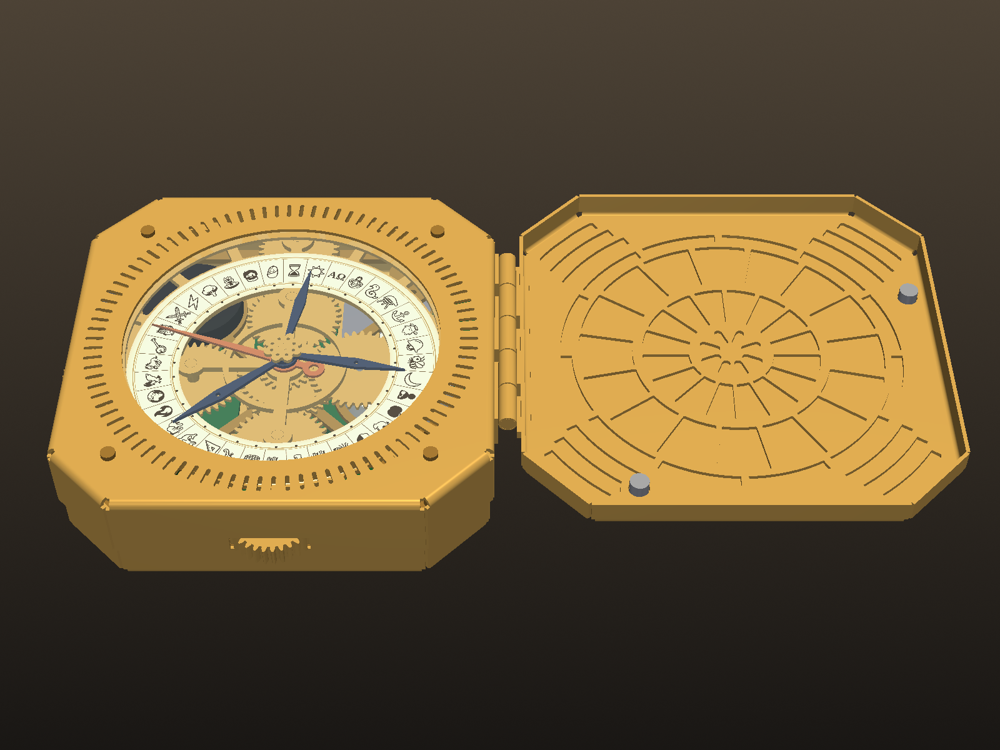
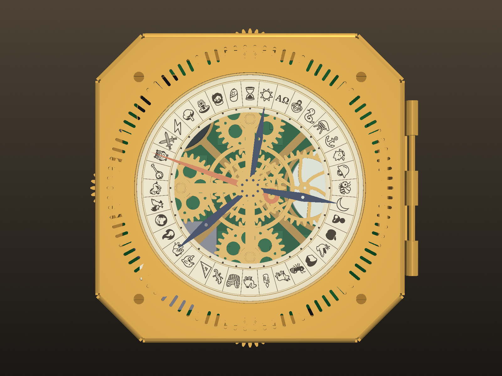
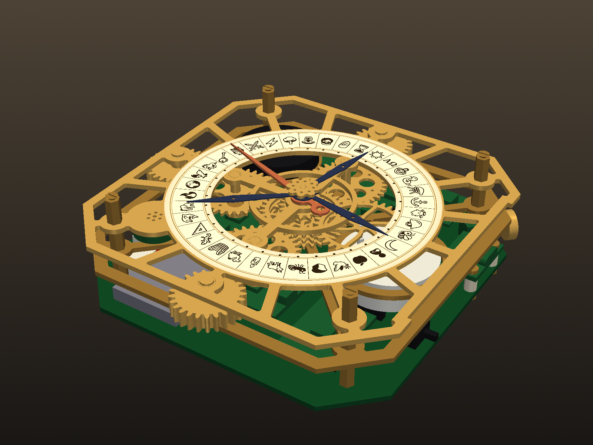
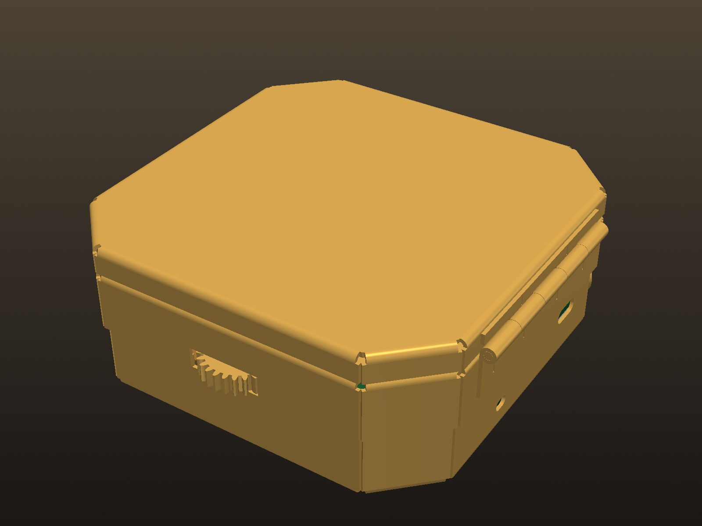
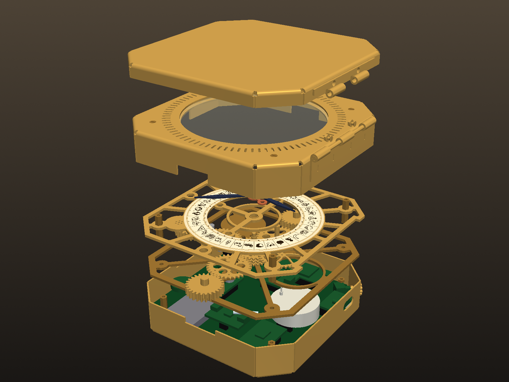
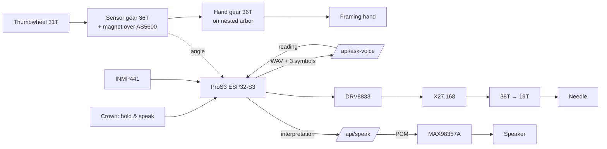

# The brass alethiometer: hardware

A working, hand-held alethiometer built from laser-cut brass, driven by the same oracle as
the website. You turn three side thumbwheels to point three hands at symbols, hold the crown
and speak your question, and the needle swings through its answer. Then the instrument reads
the interpretation aloud.



| | |
|---|---|
|  |  |
|  |  |

## What's here

| Path | What it is |
|---|---|
| [`SETUP.md`](SETUP.md) | **Start here on a new computer**: tools, regenerating everything, what to check before ordering |
| [`BOM.md`](BOM.md) | Everything to buy, with sources and rough costs |
| [`ASSEMBLY.md`](ASSEMBLY.md) | Step-by-step build |
| [`WIRING.md`](WIRING.md) | Signal diagram, pin table, and the few off-board wires |
| [`pcb/`](pcb/README.md) | **Carrier PCB**: all through-hole, every module socketed, test pads; Gerbers ready for JLCPCB/PCBWay |
| [`viewer/`](viewer/README.md) | Local 3D viewer: toggle layers and parts, explode, open the lid, section cut |
| [`out/sendcutsend/`](out/sendcutsend) | **Ready-to-upload** DXFs, one per part, with material and quantity in the filename, plus formed STEP files for the three bent parts |
| `out/alethiometer_open.glb` | Colour 3D assembly (lid open) for any glTF viewer (Windows 3D Viewer, Blender, Fusion) |
| `out/step/`, `out/alethiometer_*.step` | Full STEP for every part and the assemblies. They're too big for git (hundreds of MB), so `python cad/build.py` generates them locally. |
| [`out/renders/`](out/renders), [`out/flats/`](out/flats) | Renders and flat-pattern previews |
| [`out/build_report.json`](out/build_report.json) | Key dimensions, weight, interference and manufacturability results |
| [`dial/`](dial) | The printable dial sticker (36 symbols, website order) and its generator |
| [`cad/`](cad) | The parametric CadQuery model that generates all of the above |
| [`../firmware/`](../firmware) | ESP32-S3 firmware (PlatformIO) |

## The instrument

- **Size** 112.4 × 112.4 mm (an octagon with 16 mm chamfers). The body is 38.0 mm tall,
  45.6 mm with the lid closed. Weight is about **815 g**, almost all of it brass.
- **Electronics** sit on one through-hole [carrier PCB](pcb/README.md). Every module (ProS3,
  3 × AS5600, DRV8833, MAX98357A, X27) plugs into sockets, so any of them can be pulled to
  reflash or swap. The board has labelled test pads for every signal. The wall USB-C port and the
  crown switch are mounted on the carrier too, so plugging in and pressing the crown push on
  screws, not glue. The wall port is for flashing and charging; firmware can also be updated
  over Wi-Fi.
- **Case.** Three bent .040" brass shells: a lower tray, an upper shell that telescopes over it
  like a watch case, and a hinged lid with a pierced rosette inside. The upper shell's top face
  carries the crystal window and a ring of 90 radial slots.
- **Dial.** A printed sticker on a brass dial plate: a cream ring with 36 sepia symbols in the
  website's order, Hourglass at 12. It uses Myth Made's hand-drawn, film-style symbols, which you
  generate locally from your own download (see [`dial/`](dial/README.md)). The plate's skeleton
  window shows the gear train underneath. Acrylic crystal.
- **Three framing hands, set by hand.** Each thumbwheel (five stacked 31-tooth brass gears)
  drives a 36-tooth sensor gear, which drives a 36-tooth gear on that hand's arbor. The arbors
  are nested K&S tubes, like the hour and minute pipes of a clock. The sensor gear turns
  **1:1** with its hand and carries a magnet over an **AS5600** angle sensor. The firmware
  therefore always knows exactly where every hand points: no homing, no lost counts, and it
  works even if the knobs were turned while the instrument slept. The wheels protrude about
  4 mm through the top, left, and bottom walls, as on the BBC prop.
- **The answering needle** (copper) is driven by an **X27.168** automotive gauge stepper through
  a 38:19 brass gear pair. The motor's internal stop is kept and used to home the needle on
  every wake. The 2:1 ratio turns its 315° of travel into about 630° of needle sweep, so every
  symbol is reachable with room for theatre.
- **Hidden voice.** The speaker sits under the dial plate and sounds out through the grille
  ring on the top face. It reads as decoration, and fine mesh behind it hides the interior.
  The microphone listens through a 7-hole port in the dial plate, under the same ring. Nothing
  on the outside says "speaker" or "microphone".
- **Crown.** A small scalloped brass crown centred on the top-right corner, low on the case. Hold it to speak, release
  to ask. Triple-click opens Wi-Fi setup; five clicks starts calibration.
- **Lid.** A magnet and reed switch wake the instrument when you open the lid and send it to
  sleep when you close it. A USB-C charging port is tucked in the hinge-side wall. Battery is
  a ~350 mAh LiPo, good for roughly 40–55 readings per charge (estimated, not measured).



### The vertical stack (bottom to top)

| Z (mm) | Layer |
|---|---|
| 0 – 1.0 | lower tray floor (Kapton-lined) |
| 1.0 – 3.5 | nylon spacers |
| 3.5 – 5.1 | **carrier PCB** |
| 5.1 – 17.1 | **electronics bay**: modules on 5 mm sockets (ProS3, 3 × AS5600, DRV8833, amp), LiPo, X27 on its sockets |
| 17.1 – 18.7 | **P1**, movement base plate (bearings) |
| 19.2 – 27.2 | **gear space**, four 2 mm levels: hand I / II / III trains, then needle + motor gears; thumbwheels span L0–L2 |
| 26.7 – 28.3 | **P2**, dial plate + sticker |
| 28.8 – 34.7 | needle, hands III, II, I, cap |
| 34.3 – 38.0 | crystal spiders, crystal, top face |
| 38.0 – 45.6 | lid |

The bay height is set by the AS5600 sensors: socket, sensor board, air gap and magnet stacked
under P1. Sockets cost about 4 mm of case height compared with soldering the modules flat. That
buys a build where nothing needs desoldering to reflash, probe or replace a part.

## Ordering

1. **SendCutSend.** Upload everything in `out/sendcutsend/` (see [BOM.md §A](BOM.md)).
   - For the three bent parts (`case_*`), upload the `__formed.step` file. SendCutSend
     reads the bends from it. Check in the 3D preview that all eight flanges bend 90° to
     the same side. The model uses SendCutSend's .040" brass spec
     (inside radius .040", K-factor 0.38).
   - Everything else is a flat DXF in millimetres. Choose the material from the filename
     (`brass-040in`, `brass-063in`, `copper-032in`, `clear-acrylic-063in`) and the quantity.
2. **Carrier PCB:** upload `pcb/fab/alethiometer_carrier_gerbers.zip` to JLCPCB/PCBWay
   (2 layers, 1.6 mm; see [`pcb/README.md`](pcb/README.md)).
3. **K&S tube and rod, fasteners, electronics:** [BOM.md](BOM.md) §B–D.
4. **Dial sticker:** [`dial/README.md`](dial/README.md).

## Regenerating

```powershell
cd hardware\cad
pip install -r requirements.txt
python build.py          # ~5 min: checks, DXF/STEP, assemblies, renders, report
python build.py --check  # ~1.5 min: interference + manufacturability only
python plot_flats.py     # flat-pattern previews
```

The carrier PCB is generated from the same `cad/layout.py` positions by
[`pcb/make_pcb.py`](pcb/README.md#regenerating) (KiCad 10 + Freerouting).

Every dimension lives in [`cad/design.py`](cad/design.py): case size, stack heights, gear
module and tooth counts, hand lengths, and component positions. `build.py` runs a full pairwise
**interference check** across the assembled parts (gear teeth included) and fails if anything
collides. It also checks SendCutSend's minimum part size, thin webs, holes left floating in
voids, and the minimum flange length.

## Known risks and open questions

- **Not yet built.** The geometry is checked in CAD but no physical prototype exists yet.
  Plan for a second SendCutSend order for small parts.
- **8-flange trays** may need SendCutSend's manual review (see BOM.md).
- **Laser-cut module-0.7 gears** in .040" brass are fine at hand-setting speeds and for a gauge
  motor, but expect some backlash. Every pair is spaced 0.1 mm wider than theoretical and the
  teeth are thinned, so a worst-case cut still turns freely. Shafts run in K&S tube bushings,
  which locate them to about 0.05 mm. The firmware approaches every needle target from the
  same direction to hide the backlash. Wire-EDM gears from the same DXFs are a drop-in
  upgrade (BOM.md §A).
- **Fit tolerances** are collected at the top of `cad/design.py` (*Tolerance budget*). They're
  sized for SendCutSend's ±0.13 mm cuts and ±0.25–0.5 mm bends, so parts should assemble
  without filing.
- **X27 shaft length.** The 38T motor gear is pressed onto the Ø1 output shaft about 6.3 mm
  above the motor body. Check your motor's shaft before cutting gears.
- **Wi-Fi through brass.** The ProS3's antenna sits inside a metal case. Radio leaks out through
  the crystal window, the grille slots and the skeletonised plates, but range will be shorter
  than on the bench. Because the ProS3 is socketed, the u.FL version (**ProS3[D]**) with a small
  flex antenna under the crystal can be dropped in if needed.
- **Cloud voice** needs two extra Azure OpenAI deployments. The endpoints exist in `api/` but
  haven't been exercised against real Azure yet.
- **Weight.** About 815 g, because brass is dense. P1 can be cut from aluminium to save about
  45 g; it's fully hidden.

## Credits

The form follows the BBC/HBO *His Dark Materials* prop and is inspired by Jamie of
[Myth Made](https://www.youtube.com/watch?v=rpL9xWBeznU), whose build proved that a folded
octagonal case, side thumbwheels, and an X27 needle make a convincing instrument. The dial uses
Myth Made's free symbol artwork. It's read from your own download at build time and isn't
redistributed here. The case, movement, CAD, and electronics are original. It's an unofficial
fan project, not affiliated with the BBC, HBO, Philip Pullman, or Myth Made.
