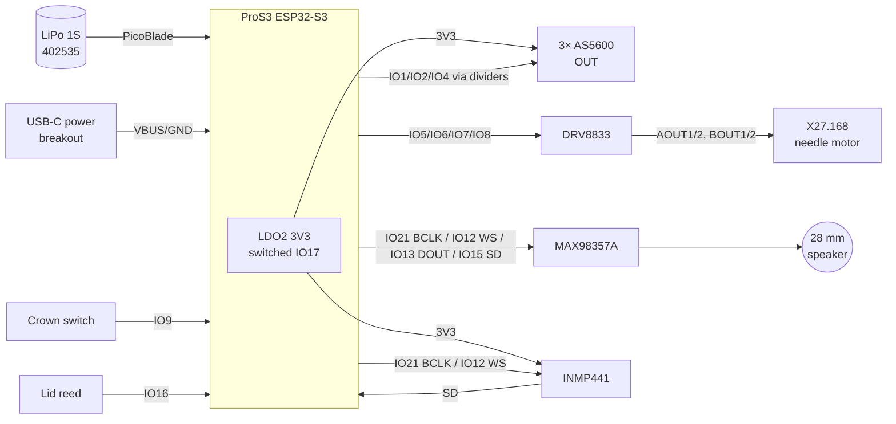

# Wiring

All modules are wired point-to-point with 30 AWG silicone or Kynar wire. Keep every
wire inside the **electronics bay** (between the case floor and plate P1). Pass wires up
to the gear space only where noted, through the open lattice of P1.

> The pin numbers are the single source of truth in [`firmware/src/config.h`](../firmware/src/config.h).
> If you change a pin there, change it here too.

## Connection table

| From | Pin | To | Notes |
|---|---|---|---|
| LiPo + / − | — | ProS3 battery (PicoBlade 1.25) | Use a cell with a PicoBlade lead, or crimp one. ProS3 charges it from USB. |
| USB-C breakout | VBUS | ProS3 **5V** pin | Power/charging only. Flash the first firmware over the ProS3's own USB-C *before* installing it; after that, update over Wi-Fi (OTA). |
| USB-C breakout | GND | ProS3 GND | |
| ProS3 | **3V3 (LDO2)** | AS5600 ×3 VCC, INMP441 VDD | LDO2 is switched by IO17 and turns off in deep sleep. |
| ProS3 | GND | AS5600 ×3 GND, INMP441 GND + L/R, DRV8833 GND, MAX98357A GND | INMP441 **L/R → GND** (left channel). |
| AS5600 I (top, 12 o'clock) | OUT | 10 kΩ → **IO1**; 47 kΩ IO1 → GND | Divider keeps the 0–3.3 V output inside the ADC range. |
| AS5600 II (left, 9 o'clock) | OUT | 10 kΩ → **IO2**; 47 kΩ IO2 → GND | |
| AS5600 III (bottom, 6 o'clock) | OUT | 10 kΩ → **IO4**; 47 kΩ IO4 → GND | |
| AS5600 ×3 | DIR | GND | Fixes the direction; calibration handles the sign either way. |
| AS5600 ×3 | SDA, SCL, PGO | — | Leave unconnected (analog mode). |
| ProS3 | **IO5 / IO6** | DRV8833 AIN1 / AIN2 | Coil A |
| ProS3 | **IO7 / IO8** | DRV8833 BIN1 / BIN2 | Coil B |
| ProS3 | VBAT | DRV8833 VM | |
| ProS3 | 3V3 (LDO2) | DRV8833 SLP | Driver sleeps whenever LDO2 is off. |
| DRV8833 | AOUT1, AOUT2 | X27 pins 1, 2 (coil A) | X27 rear pins are bent flat and soldered. See `firmware/README.md` if the needle homes the wrong way (`MOTOR_PHASE_DIR`). |
| DRV8833 | BOUT1, BOUT2 | X27 pins 3, 4 (coil B) | |
| ProS3 | **IO21** | MAX98357A BCLK **and** INMP441 SCK | Shared I2S bus |
| ProS3 | **IO12** | MAX98357A LRC **and** INMP441 WS | |
| ProS3 | **IO13** | MAX98357A DIN | |
| ProS3 | **IO14** | INMP441 SD | |
| ProS3 | **IO15** | MAX98357A SD | HIGH = on (left channel), LOW = shutdown |
| ProS3 | VBAT | MAX98357A VIN | |
| MAX98357A | + / − | Speaker | Leave GAIN unconnected (9 dB). |
| Crown tactile switch | — | **IO9** ↔ GND | Internal pull-up; also the deep-sleep wake button. |
| Lid reed switch | — | **IO16** ↔ GND | Add a **1 MΩ** pull-up IO16 → 3V3 (LDO1/main 3V3, not LDO2). LOW = lid closed. |

## Where things go

The bay layout is modelled in `hardware/cad/design.py` (`electronics()`) and checked
for collisions. Heights are measured above the inside of the floor.

| Module | Position (x, y mm from dial centre; +x = hinge, +y = 12 o'clock) | Mounting |
|---|---|---|
| ProS3 | strip x −1…52, y ±9 | 0.3 mm foam tape on the floor. The X27 sits above its middle. |
| LiPo 402535 | x 13…48, y 12.6…37.6 (top-right) | Foam tape; keep the corner standoff clear. |
| DRV8833 | centred (25, −23) (bottom-right) | Foam tape |
| MAX98357A | centred (−30, 26) (top-left) | Foam tape |
| AS5600 ×3 | chip centred exactly under each sensor shaft: (0, 25.2), (−25.2, 0), (0, −25.2) | Raise the board on ~1.8 mm foam so the chip sits **0.5–1.0 mm** below the magnet. Use the P1 bearing holes as a template. |
| X27.168 | body centre (29.95, 0), shaft at (19.95, 0) | Through P1's Ø31 cutout; fix with a fillet of 5-min epoxy. |
| Speaker | (−28.5, 28.5) on top of P1 | Foam ring. It fires up through P2's open lattice to the grille ring. |
| INMP441 | (−32, −32) under P2, port facing up | Foam tape with a hole over the port, under P2's 7-hole mic port. |
| Reed switch | under the top face at r 53.6 mm, 300° (lower right) | Epoxy; its lid magnet sits directly above it. |
| USB-C breakout | right wall, receptacle centre y = 22.5, 15.8 mm above the case bottom | Epoxy the board to a 2 mm spacer on P1 so the receptacle is flush with the outer wall. |
| Crown switch | on a perfboard tab epoxied to P1, behind the top-right chamfer | Switch face 9.5 mm inside the wall, on the crown axis |
