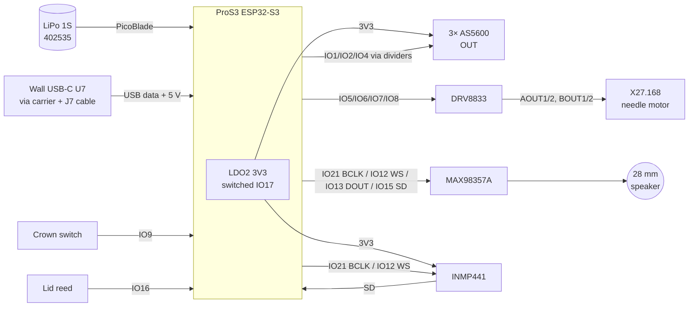

# Wiring

Almost all of this is on the [carrier PCB](pcb/README.md): every module plugs into sockets
on it and the board makes the connections below. The only wires are to the three off-board parts
(mic, speaker, lid reed), which solder to labelled pads J4–J6, plus the battery lead and a
short USB-C cable from the ProS3's port to J7. The crown switch and the wall USB-C port are on
the carrier. This page is the signal reference. For per-pad
detail see [`pcb/NETLIST.md`](pcb/NETLIST.md).

> The pin numbers are the single source of truth in [`firmware/src/config.h`](../firmware/src/config.h).
> If you change a pin there, change it here too.

## Connection table

| From | Pin | To | Notes |
|---|---|---|---|
| LiPo + / − | — | ProS3 battery (PicoBlade 1.25) | Use a cell with a PicoBlade lead, or crimp one. ProS3 charges it from USB. |
| Wall USB-C (U7) | VBUS, D+, D−, GND | J7 → short cable → ProS3 USB-C | Charging, serial console and flashing with the case closed. OTA also works. |
| ProS3 | **3V3 (LDO2)** | AS5600 ×3 VCC, INMP441 VDD | LDO2 is switched by IO17 and turns off in deep sleep. |
| ProS3 | GND | AS5600 ×3 GND, INMP441 GND + L/R, DRV8833 GND, MAX98357A GND | INMP441 **L/R → GND** (left channel). |
| AS5600 I (top, 12 o'clock) | OUT | 10 kΩ → **IO1**; 47 kΩ IO1 → GND | Divider keeps the 0–3.3 V output inside the ADC range. |
| AS5600 II (left, 9 o'clock) | OUT | 10 kΩ → **IO2**; 47 kΩ IO2 → GND | |
| AS5600 III (bottom, 6 o'clock) | OUT | 10 kΩ → **IO4**; 47 kΩ IO4 → GND | |
| AS5600 ×3 | SDA, SCL, 3Vo | — | Unconnected (analog mode; the Adafruit board fixes DIR). Calibration handles the sign. |
| ProS3 | **IO5 / IO6** | DRV8833 AIN1 / AIN2 | Coil A |
| ProS3 | **IO7 / IO8** | DRV8833 BIN1 / BIN2 | Coil B |
| ProS3 | VBAT | DRV8833 VM | |
| ProS3 | 3V3 (LDO2) | DRV8833 SLP | Driver sleeps whenever LDO2 is off. |
| DRV8833 | AOUT1, AOUT2 | X27 pins 1, 2 (coil A) | Through the X27's sockets. See `firmware/README.md` if the needle homes the wrong way (`MOTOR_PHASE_DIR`). |
| DRV8833 | BOUT1, BOUT2 | X27 pins 3, 4 (coil B) | |
| ProS3 | **IO21** | MAX98357A BCLK **and** INMP441 SCK | Shared I2S bus |
| ProS3 | **IO12** | MAX98357A LRC **and** INMP441 WS | |
| ProS3 | **IO13** | MAX98357A DIN | |
| ProS3 | **IO14** | INMP441 SD | |
| ProS3 | **IO15** | MAX98357A SD | HIGH = on (left channel), LOW = shutdown |
| ProS3 | VBAT | MAX98357A VIN | |
| MAX98357A | + / − | **J5** → speaker | Through the amp's two speaker-pin sockets. GAIN is unconnected (9 dB). |
| Crown switch SW1 | — | IO9 ↔ GND (on the carrier) | Internal pull-up; also the deep-sleep wake button. |
| Lid reed switch | — | **J6**: IO16 ↔ GND | R7 (1 MΩ) pulls IO16 up to the always-on 3V3 (not LDO2). LOW = lid closed. |
| INMP441 | VDD GND SCK WS SD | **J4** | Tie the mic's L/R pin to GND at the mic. |

## Where things go

Module positions come from [`cad/layout.py`](cad/layout.py), which both the CAD model and the PCB
generator read. Coordinates are x, y in mm from the dial centre; +x = hinge, +y = 12 o'clock.

| Part | Position | Mounting |
|---|---|---|
| ProS3 | centre (4, 43.4), USB-C toward −x | 2 × 1×17 sockets on the carrier; cable to J7 |
| AS5600 ×3 | chips under the sensor shafts: (0, 25.2), (−25.2, 0), (0, −25.2) | 1×6 socket + rest post. Chip about 1.1 mm below its magnet. |
| DRV8833 | centre (28, −31) | 1×8 + 1×6 sockets |
| MAX98357A | centre (−32, 24.5) | 1×7 socket + two speaker-pin sockets |
| X27.168 | body centre (29.95, 0), shaft (19.95, 0) | Two 1×4 sockets on the carrier; located sideways by P1's slot (slide to set mesh) |
| LiPo 402535 | x −37…−13, y −48…−13 | Foam tape on the carrier's `BATTERY` area; PicoBlade lead to the ProS3 |
| Speaker | (−28.5, 28.5) on top of P1 | Foam ring. It fires up through P2's lattice to the grille ring. P1's seat is a ring (Ø22 opening) so the speaker's back vents into the bay. Two leads from its back tabs drop through that opening onto **J5**, directly below. |
| INMP441 | (−32, −32) under P2, port up | Foam tape with a hole over the port, under P2's 7-hole mic port. Five leads drop through P1's open lattice at about (−42, −25) onto **J4** at (−46, −17 … −27). |
| Reed switch | under the top face at r 53.6 mm, 300° | Epoxy; its lid magnet sits directly above it. Leads to J6. |
| Crown switch | carrier, top-right corner, on the crown axis | Omron B3F-3150 soldered to the carrier |
| Wall USB-C | right wall, receptacle centre y = 23.5 | Adafruit #4090 on a socket, screwed to the carrier on two spacers |

Make the off-board leads about 10 cm long, enough to lift the upper shell clear and lay it
beside the base. Solder them into J4–J6; a plug standing up wouldn't fit under P1. An inline
connector partway along a lead makes that part unpluggable.
