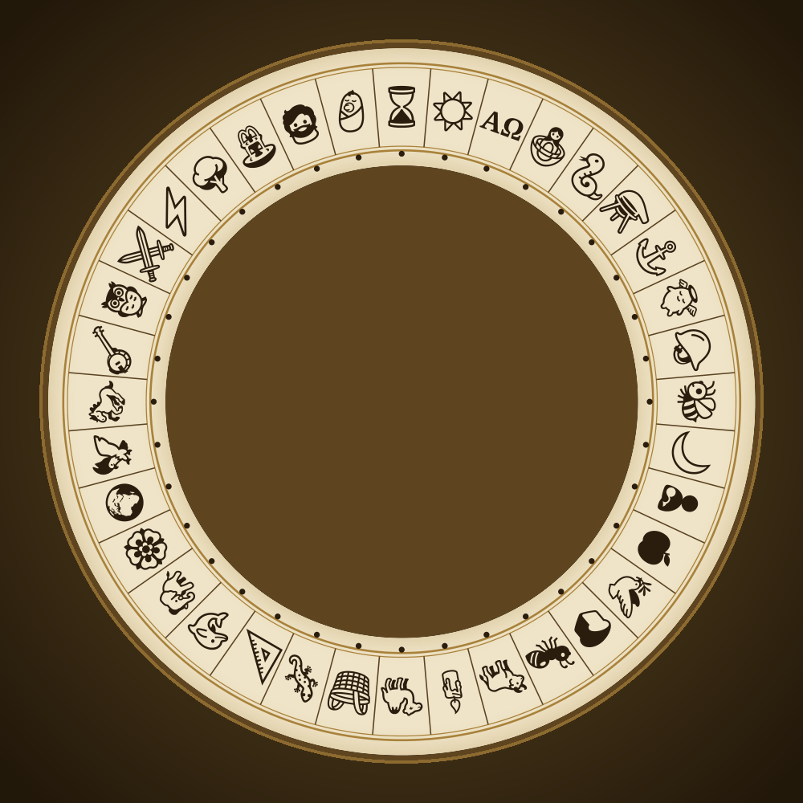

# Alethiometer dial-face sticker

Printable, 1:1 dial face for the physical brass alethiometer: an ivory ring
with dark sepia silhouette symbols, fine gilt rules and dark tick separators,
in the style of the film prop.



The 36 symbols are read from [`js/symbols.js`](../../js/symbols.js) in wheel
order — symbol *i* sits at *i* × 10° clockwise from 12 o'clock (Hourglass at
12, Sun next clockwise), exactly matching the website. Each glyph is rotated
so its top faces outward from the centre.

## Files

| File | Purpose |
| --- | --- |
| `make_dial.py` | Generator — regenerates everything below, deterministically |
| `dial.svg` | 1:1 vector art (mm units, `viewBox` centred on the dial) with a separate `<g id="cutlines">` (0.1 mm `#FF0000` circles) |
| `dial_print_letter.pdf` | US Letter sheet: one dial with red cut lines, one spare without, crop + registration marks, a 50 mm scale-check bar |
| `dial_1200dpi.png` | Dial only (no cut lines), 1200 dpi, transparent outside the annulus — for sticker services |
| `dial_preview.png` | 1000 px preview on a dark brass background |
| `fonts/` | Source fonts and their OFL licences |

## Geometry (mm, from the dial centre)

| Element | Value |
| --- | --- |
| Cut lines | inner r 29.0 (Ø 58.0), outer r 41.4 (Ø 82.8) |
| Background art (with 0.8 mm bleed) | r 28.2 – 42.2 (artboard 84.4 × 84.4) |
| Gilt rules `#A8813A` | r 30.0 and 40.4 @ 0.25; hairlines r 30.5 and 39.9 @ 0.12 |
| Separator ticks `#5A4322` | 36 at (i + ½) × 10°, r 30.5 – 39.9 @ 0.15 |
| Symbols `#2A1D0E` | centred at r 35.2; larger bbox side ≈ 5.0 (small optical tweaks, never > 5.6) |
| Index pips `#2A1D0E` | dot r 0.35 at r 29.6 on each symbol angle (aim point for the hand tips) |
| Ground | ivory `#EFE4C8`, subtle vignette to `#E2D2AC` at both edges |

The vignette is an SVG `radialGradient` in `dial.svg`. MuPDF (used to make
the PDF and PNGs) does not render SVG gradients, so those outputs use the same
colour curve as fine (0.1 mm) concentric vector rings — visually identical.

## Regenerate

```powershell
pip install fonttools pymupdf pillow
python hardware/dial/make_dial.py
```

The script prints the measured cut-circle diameters from the finished PDF
(it fails if they are not 82.8 mm / 58.0 mm) and a SHA-256 of each output;
re-running produces byte-identical files. Tweak per-symbol optical size in
the `OPTICAL` table in `make_dial.py`.

## Printing

### At home (inkjet)

1. Print `dial_print_letter.pdf` at **100 % / Actual size** (turn off "fit to
   page"/"shrink to fit"). Use **matte white or cream adhesive vinyl** or
   **matte photo sticker paper** made for inkjet; highest quality, matte
   paper setting.
2. Measure the 50 mm bar with a ruler or calipers before cutting. If it is
   off, fix the printer scaling — don't trust the screen.
3. Let the ink dry fully (a few hours for vinyl), then laminate with a
   **clear matte cold laminate** (e.g. a matte self-adhesive overlaminate
   film or clear matte sticker laminate sheets) to protect against
   fingerprints and UV, and to keep the antique non-glossy look. Laminate
   before cutting so the edges are sealed by the cut.
4. Cut the outer circle (Ø 82.8) and the inner hole (Ø 58.0). A compass
   circle cutter such as the **Olfa CMP-1** gives clean circles: put the
   pivot on the small centre cross (it lies in the waste hole). Cut on the
   red lines; the 0.8 mm bleed means slight misalignment won't show white.

The second, cut-line-free copy on the sheet is a spare.

### Sticker service

Upload `dial_1200dpi.png` (or `dial.svg`) to a custom-shape sticker service
such as **StickerApp** or **Sticker Mule**, choosing matte vinyl/laminate.
The PNG is transparent outside the annulus, sized 84.4 mm including bleed;
the finished sticker should be **Ø 82.8 mm** outer. Note the centre hole:
many services can't cut an interior hole. In that case order a full disc
(with a flat or transparent centre) and cut the Ø 58.0 mm hole yourself with
a compass circle cutter like the Olfa CMP-1, centred on the printed ring.

## Glyph sources and substitutions

* Symbols: **Noto Emoji** (monochrome, variable) instanced at `wght=600` with
  `fontTools.varLib.instancer`, outlines extracted with `SVGPathPen`.
  Variation selectors (U+FE0F) and ZWJs are stripped; multi-codepoint glyphs
  are laid out by advance width.
* Alpha & Omega (`ΑΩ`): **Noto Serif** instanced at Bold (`wght=700`), the two
  letters set side by side as paths. Captions on the print sheet use Noto
  Serif Regular, also outlined.
* All glyphs and text are converted to vector paths; no output needs a font.

Coverage: every codepoint used by `js/symbols.js` is present in Noto Emoji,
including the newer 🪆 U+1FA86, 🪖 U+1FA96 and 🪕 U+1FA95, so **no
substitutions were needed**. Note that the website's emoji choices are kept
as-is for consistency, so a few symbols are emoji stand-ins: Marionette is
🪆 (nesting dolls), Lute is 🪕 (banjo), Compasses is 📐 (set square),
Cornucopia is 🧺 (basket), Griffin is 🦅 (eagle), Walled Garden is ⛲
(fountain), Cauldron is ⚗️ (alembic), Garland is 🏵️ (rosette).

## Licences / attribution

* Noto Emoji — Copyright 2013 Google LLC, SIL Open Font License 1.1
  (`fonts/OFL-NotoEmoji.txt`), from
  [google/fonts `ofl/notoemoji`](https://github.com/google/fonts/tree/main/ofl/notoemoji).
* Noto Serif — Copyright 2022 The Noto Project Authors, SIL Open Font
  License 1.1 (`fonts/OFL-NotoSerif.txt`), from
  [google/fonts `ofl/notoserif`](https://github.com/google/fonts/tree/main/ofl/notoserif).

The OFL permits embedding/outlining glyphs in artwork such as this; the font
files are redistributed unmodified alongside their licence texts.
