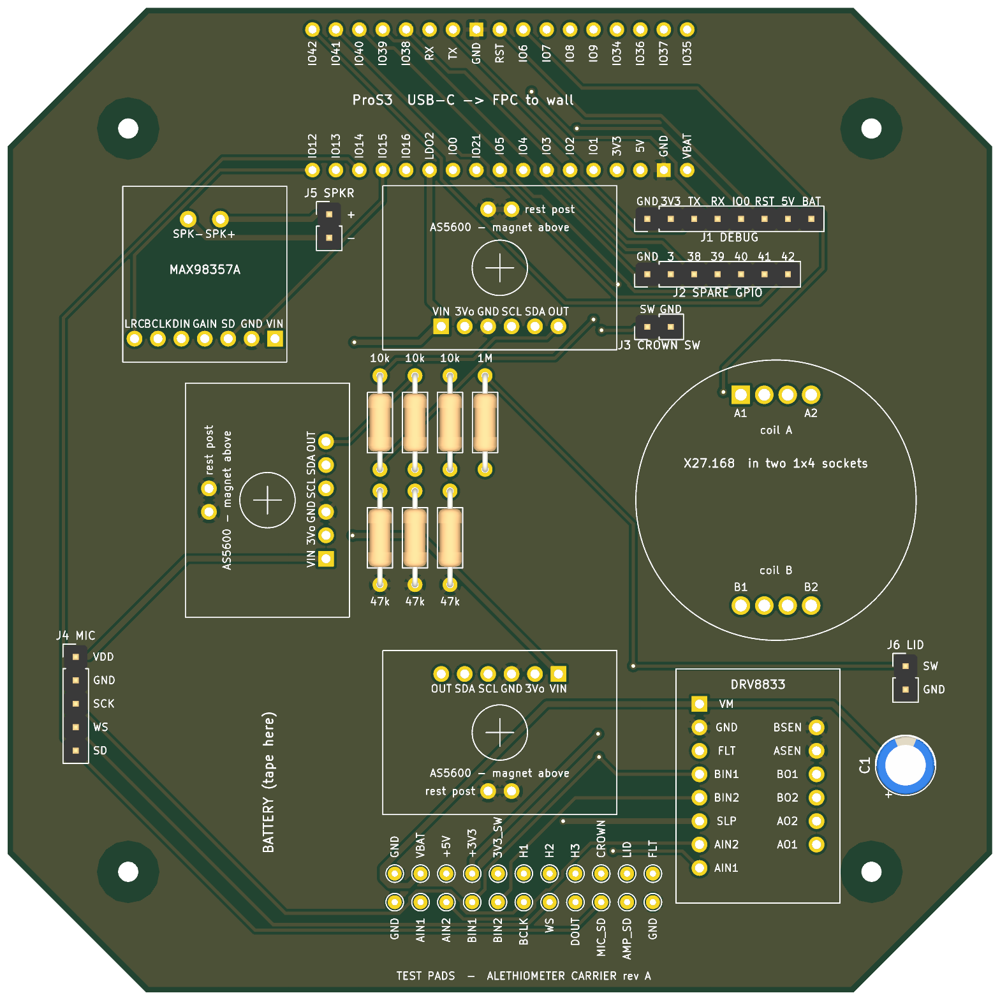

# Carrier PCB

One octagonal, two-layer, **all through-hole** board in the bottom of the case. It replaces the
point-to-point wiring. **Every module plugs into sockets**, so you can pull any of them to
reflash, probe or replace it without desoldering anything. Off-board parts (mic, speaker,
crown switch, lid reed) connect to labelled pin rows. Every signal also has a labelled test pad.



| File | What it is |
|---|---|
| `make_pcb.py` | Generates the whole board from [`../cad/layout.py`](../cad/layout.py) (the same positions the CAD model uses) |
| `alethiometer_carrier.kicad_pcb` | The KiCad 10 board. Open it to inspect or tweak. |
| `fab/alethiometer_carrier_gerbers.zip` | **Upload this to the PCB fab** |
| `fab/plot_top.pdf`, `fab/plot_bottom.pdf` | 1:1 prints for checking parts against the board before soldering |
| `fab/render_top.png`, `fab/render_bottom.png` | 3D renders |
| `NETLIST.md` | Every net and the pads on it |
| `drc_report.json` | KiCad DRC (0 violations, 0 unconnected) |
| `alethiometer.pretty/` | Footprints: the Adafruit modules, the X27, and Unexpected Maker's ProS3 (CERN-OHL-1.2) |

## Ordering the board

JLCPCB, PCBWay, OSH Park and similar fabs all work. Upload `fab/alethiometer_carrier_gerbers.zip`
and pick:

- **2 layers, FR-4, 1.6 mm**, 1 oz copper;
- HASL (lead-free) or ENIG, any solder-mask colour;
- no assembly service (it's all through-hole);
- leave "remove order number" at the default, or pay for it.

The board is about 108 mm across, a little over the 100 × 100 mm price break, so expect roughly $10–20 for five
boards plus shipping.

## Bill of materials (carrier)

| Ref | Part | Qty | Notes |
|---|---|---|---|
| — | Carrier PCB (above) | 1 | |
| U1 | **Unexpected Maker ProS3** (ESP32-S3) | 1 | Solder its two 1×17 male headers on, pins down |
| U2–U4 | **Adafruit AS5600** magnetic angle sensor, STEMMA QT (#6357) | 3 | Header included. Use the 1×6 row only. |
| U5 | **Adafruit DRV8833** dual H-bridge (#3297) | 1 | Header included (1×8 + 1×6) |
| U6 | **Adafruit MAX98357A** I2S amp (#3006) | 1 | Header included. Leave the screw terminal off. |
| M1 | **Juken/Switec X27.168** gauge stepper (keep its internal stop) | 1 | Adafruit #2424 or AliExpress |
| — | **Short female header, 0.1", 5 mm body** (Adafruit #3008, 5 × 36-pin) | 1 pack | Cut into the module sockets: 2× 1×17 (ProS3), 3× 1×6 + 3× 1×2 (AS5600 + rest posts), 1×8 + 1×6 (DRV8833), 1×7 + 2× 1×1 (MAX98357A) |
| — | **Female header 1×4, 0.1", standard 8.5 mm** (e.g. Sullins PPTC041LFBN-RC) | 2 | X27 sockets |
| — | Male header strip 0.1", 1×40 | 1 | AS5600 rest posts, MAX98357A speaker pins, J1–J6 |
| R1, R3, R5 | 10 kΩ, ¼ W metal film, 0.4" (10.16 mm) lead pitch | 3 | Series resistors of the hand-sensor dividers |
| R2, R4, R6 | 47 kΩ, ¼ W metal film | 3 | Divider shunts (`HAND_DIVIDER_RATIO` = 57/47 in firmware) |
| R7 | 1 MΩ, ¼ W metal film | 1 | Lid pull-up to the always-on 3V3 |
| C1 | 100 µF 10–16 V aluminium electrolytic, radial Ø6.3 mm, 2.5 mm pitch, ≤ 12 mm tall | 1 | Bulk cap on VBAT for the motor and amp. **Polarised.** |
| — | Dupont female-female jumper leads, 10 cm | ~12 | Off-board parts to J3–J6 (or solder wires) |
| — | M2 nylon round spacer, 2.5 mm × Ø4.5 | 4 | Between the case floor and the board |
| — | M2 × 15 mm brass hex standoff, female-female | 4 | Board → P1 |
| — | M2 × 8 mm brass cheese-head screw | 4 | Floor → spacer → board → standoff |
| — | Kapton tape | | One layer on the case floor under the board |
| — | USB-C male-to-female **FPC ribbon extension**, about 10 cm, USB 2.0 data, female end with screw ears | 1 | ProS3 USB-C → the case's right wall (power, charging and flashing) |

## How it goes together

The board stands on four nylon spacers above a Kapton-lined floor. Brass M2 × 15 standoffs carry
plate P1 above it. Around the four post holes the board has a 3.4 mm copper keep-out, so the brass
case never touches a net. The 15 mm bay leaves room for the 5 mm sockets plus 2.5 mm of header
plastic under each module. The three AS5600 chips end up about **1.1 mm below their magnets**.

```
 P1 (brass)                 ────────────────────────────────────────
                                magnet ▒▒        X27 body ██████
 M2×15 standoff ║          AS5600 ▬▬▬▬▬▬▬           │  │
                ║          header ▮                 │  │
                ║          socket ▮   rest post ▮   socket (8.5)
 carrier PCB    ═══════════════════════════════════════════════════
 nylon spacer   ▯  Kapton  ─────────────────────────────────────────
 case floor     ════════════════════════════════════════════════════
```

**Socket positions** (the silkscreen shows the module outlines and every pin name):

- **ProS3 (U1).** Two 1×17 rows, with its USB-C toward the right wall. The FPC extension runs
  from it to the wall.
- **AS5600 ×3 (U2–U4).** Each chip sits exactly under its sensor shaft. The 1×6 row faces the
  dial centre. A **rest post** under the far edge (a 1×2 socket with a 1×2 male header whose
  top pins are clipped flush) holds the board level at the same height as the header row. Its
  pads are grounded. Only VIN, GND and OUT are used; leave SDA, SCL and 3Vo unconnected.
- **DRV8833 (U5).** A 1×8 row (VM … AIN1) and a 1×6 row (AO1 … BSEN). BSEN and ASEN are grounded on the board.
- **MAX98357A (U6).** The 1×7 row, plus two single-pin sockets under its **SPK−/SPK+** holes. Solder a
  single male pin into each of those holes. They carry the speaker signal to **J5** and support
  the board's far edge.
- **X27.168 (M1).** Its four rear pins plug into two **standard 8.5 mm 1×4** sockets (outer
  positions only). The holes are 1.3 mm, so the sockets can float about 0.3 mm. Solder them
  only once the gear mesh is set (below).

**Off-board connections.** Fit 0.1" male headers, or solder wires straight in.

| Ref | Pins (silkscreen) | Goes to |
|---|---|---|
| J1 DEBUG | GND 3V3 TX RX IO0 RST 5V BAT | USB-serial adapter / probes. Hold IO0 low and tap RST for ROM download mode. |
| J2 SPARE GPIO | GND 3 38 39 40 41 42 | Free ESP32-S3 pins for later ideas |
| J3 CROWN SW | SW GND | Crown tactile switch |
| J4 MIC | VDD GND SCK WS SD | INMP441 (tie its L/R pin to GND at the mic) |
| J5 SPKR | + − | 28 mm speaker |
| J6 LID | SW GND | Lid reed switch |

## Assembly order

1. **Check the bare board** with a multimeter. The GND test pad must not be shorted to `VBAT`,
   `+5V`, `+3V3` or `3V3_SW`.
2. **Resistors and C1.** R1–R7 lie flat. C1's long leg (+) goes to the square pad marked `+`.
   Clip the leads.
3. **Male headers** for J1–J6 (and J2 if you want it).
4. **Module sockets: use the modules as jigs.** Cut each socket strip to length (you lose one
   position at each cut; file it smooth). Push the module's own male header into the strip, drop
   the strip into the board, and solder **one** pin. Check that the strip is square and flat, then
   solder the rest. Then solder the male header to the module while it's still plugged in. This
   keeps every pair aligned. Build each AS5600 rest post the same way, then clip its top pins
   flush with the plastic.
5. **Battery.** Stick it to the `BATTERY` area with foam tape and plug its PicoBlade lead into the ProS3.
6. **X27.** Plug the motor into its two 1×4 sockets, but **don't solder the sockets yet**.
   ASSEMBLY.md §5 uses the board and P1 as a jig to set the gear mesh, then you solder them.
7. **Kapton** on the case floor. Spacers, board, then the standoffs, fixed with M2 × 8 screws
   from below.

## Bring-up checklist

Do this on the bench before closing the case. Everything is reachable from the top through
the **test pads** in the bottom strip and J1. Every pad is labelled with its net.

| Step | Fitted | Check |
|---|---|---|
| 1 | Bare board + passives | Resistance GND↔`+3V3`, `+5V`, `VBAT`, `3V3_SW` all > 1 kΩ. `H1`/`H2`/`H3` → GND ≈ 47 kΩ. `LID` → `+3V3` ≈ 1 MΩ. |
| 2 | ProS3 only, USB connected | `+5V` ≈ 5.0 V, `+3V3` ≈ 3.3 V, `VBAT` ≈ 4.2 V (charging or battery). Flash the firmware (see [`../../firmware/README.md`](../../firmware/README.md)) and open the serial monitor. |
| 3 | + AS5600 ×3 | `3V3_SW` ≈ 3.3 V while awake. `hands` prints three angles. Turning a magnet over each chip moves `H1`–`H3` between about 0 and 2.7 V. |
| 4 | + DRV8833 + X27 | `FLT` reads high (no fault). `home` buzzes the needle against its stop, and `sweep` visits the symbols. You can scope `AIN1`/`AIN2`/`BIN1`/`BIN2`. If it homes the wrong way, set `MOTOR_PHASE_DIR = -1`. |
| 5 | + MAX98357A + speaker | `tone` (or `tone 440`) beeps. `AMP_SD` is high while it plays. `BCLK`/`WS`/`DOUT` carry I2S. |
| 6 | + INMP441 on J4 | `rec` records and plays back. `MIC_SD` carries data. |
| 7 | Crown / lid | Short `CROWN` or `LID` to an adjacent GND pad. `status` shows the change, and a crown press wakes it from `sleep`. |

**Firmware iteration.** The ProS3's native USB (CDC serial + the ESP32-S3's built-in USB-JTAG
auto-reset) reaches the outside through the FPC extension, so `pio run -t upload` works with
the case closed. Over the air (OTA) works once a device key is set. If a bad build ever
bricks USB, use J1 with any 3.3 V USB-serial adapter: TX↔RX, RX↔TX, GND; hold IO0 to GND and
tap RST.

## Regenerating

You need KiCad 10 and Java 17+. Download `freerouting-1.9.0.jar` from
[github.com/freerouting/freerouting/releases](https://github.com/freerouting/freerouting/releases).
Freerouting 2.x's native CLI crashes on Windows.

```powershell
& "$env:LOCALAPPDATA\Programs\KiCad\10.0\bin\python.exe" hardware\pcb\make_pcb.py --freerouting path\to\freerouting-1.9.0.jar
```

The script places everything from `cad/layout.py`, routes the board (power nets 0.6 mm,
signals 0.35 mm, GND pours on both sides), refills the zones, runs DRC and exports `fab/`. If you
move a module in `layout.py`, rerun this script and `cad/build.py` together. The CAD model uses
the same positions.
