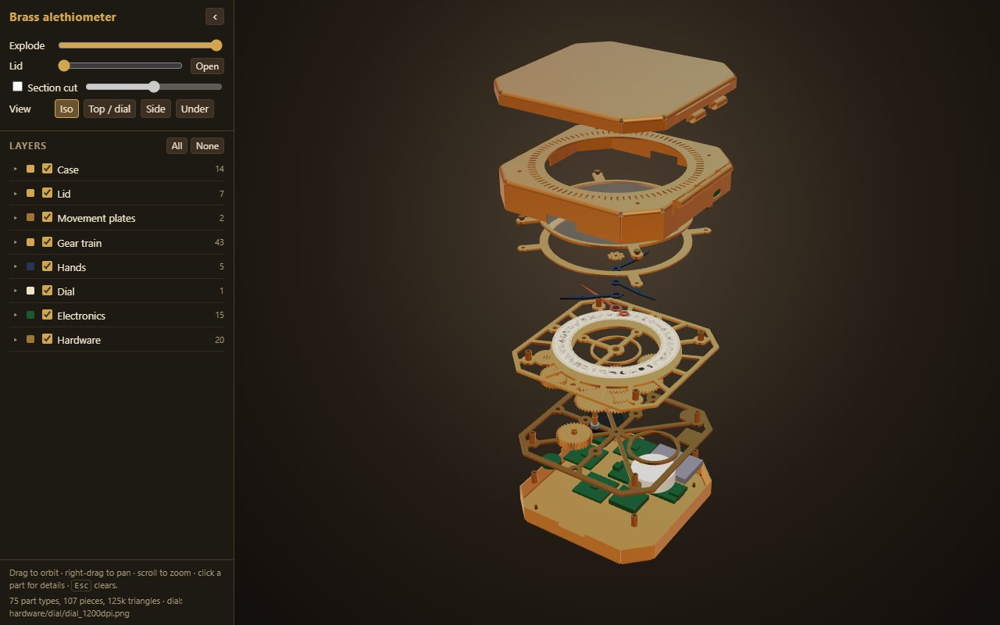

# Design viewer

A small local web viewer for the brass alethiometer CAD in [`../cad/`](../cad). Toggle layers
on and off, explode the stack, open and close the lid, and cut a section to see how it all fits
together.



## Run it

From the repository root:

```powershell
python hardware/viewer/export_viewer.py
python -m http.server 8765 --directory hardware/viewer
```

Then open <http://localhost:8765>. Run the first command again whenever `cad/design.py`
changes, then reload the page.

The exporter needs the same Python environment as `cad/build.py` (`pip install -r
hardware/cad/requirements.txt`) and takes about 20 seconds. It writes `assets/`, which is
git-ignored:

| File | What it is |
|---|---|
| `assets/alethiometer.glb` | One mesh per part type in its own frame, tessellated at 0.1 mm (about 2 MB) |
| `assets/parts.json` | For each part: group, kind, material, spec, quantity, colour, Z range, placement matrices, open-lid transform, explode offset. Also the hinge axis. |
| `assets/dial.png` | The dial sticker texture, downscaled to 2048 px. It uses `dial/local/dial_1200dpi.png` (the Myth Made art) if you've generated it, or the committed `dial/dial_1200dpi.png` otherwise. |

three.js is loaded from the jsDelivr CDN, so the page needs internet access. The brass
reflections use an HDR environment from the same CDN. If that fails to load, the viewer falls
back to a built-in studio environment.

## What it does

- **Layers:** checkboxes for case, lid, movement plates, gear train, hands, dial, electronics, and
  hardware. Expand a group (▸) to toggle individual parts. **All** and **None** set everything at once.
- **Explode:** lifts each layer by its place in the stack: tray, electronics, P1, gear train (each
  gear level slightly apart), P2 and dial, hands, crystal, upper shell, lid.
- **Lid:** the slider sets the lid angle about the real hinge axis. The button animates it open
  or closed.
- **Section cut:** a clip plane through the middle (the XZ plane). The slider moves it front to back.
- **Views:** Iso, Top / dial, Side, Under. The camera re-frames when you explode or move the lid.
- **Click a part** to see its name, layer, kind, material, spec, quantity, and Z range. From the
  info card, **Isolate** shows only that part and **Hide** hides it. <kbd>Esc</kbd> clears the
  selection.

The page exposes `window.viewer` (`setExplode`, `setLid`, `setSection`, `setView`, `setGroup`,
`select`) for scripted screenshots.
